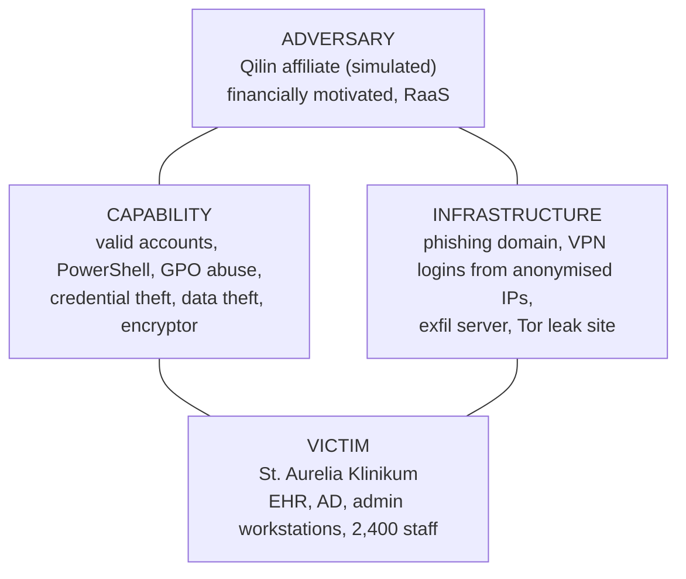

# Diamond Model: the St. Aurelia intrusion (Ch. 4 draft, owner: Tejas)

The Diamond Model describes one intrusion event through four connected features. Fill in the lab-specific values (IPs, times) after the emulation on 12 Nov.

| Feature | Detail for our scenario | Evidence we will show |
| --- | --- | --- |
| Adversary | Qilin RaaS affiliate; operator and affiliate roles split | CTI sources (actor profile) |
| Capability | T1078/T1133, T1059.001, T1053.005, T1555.003, T1003.001, T1213, T1070.001, T1490, T1486 | Wazuh alerts mapped to techniques |
| Infrastructure | Lab stand-ins: attacker host = the 10.10.50.x lab IP that ran the tests; the exfil destination is a lab address | `cti/iocs.csv`, run log |
| Victim | Admin workstation ws-admin01, EHR server ehr-srv01, 500 synthetic patients | Asset list, FIM and EHR alerts |

**Meta-features:**
- **Timestamp:** from the run log.
- **Phase:** map each event to its kill-chain stage.
- **Result:** data exposed and EHR unavailable.
- **Direction:** adversary to victim, then victim to infrastructure for the exfiltration.
- **Methodology:** double extortion.

**Pivoting.** Explain how one feature leads to another. For example, the exfiltration IP (infrastructure) leads to other victims that contacted the same address. This is how CTI teams find other affected organizations.
