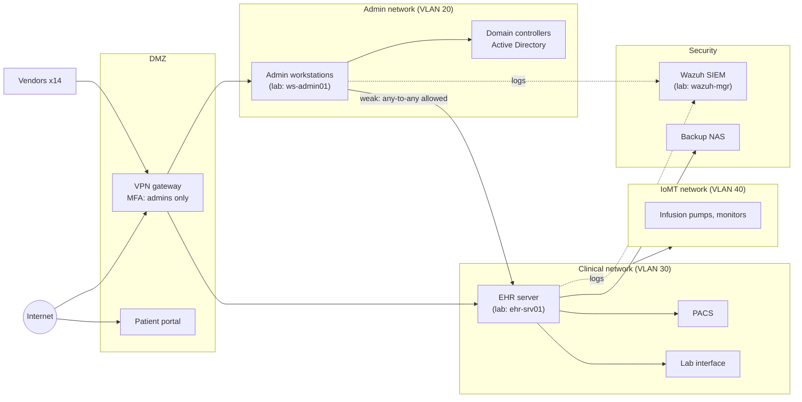

# Network diagram (owner: Arjun)

GitHub renders this Mermaid diagram automatically. For the report, export it as a PNG from https://mermaid.live, or redraw it in draw.io.

**Deliberate weaknesses.** The incident and the lessons learned in chapter 8 rely on these:

1. The VPN requires MFA only for IT admins.
2. The admin network can reach the EHR on any port.
3. The backup NAS is joined to the domain and reachable from the admin network.
4. The SIEM is monitored only during office hours.
